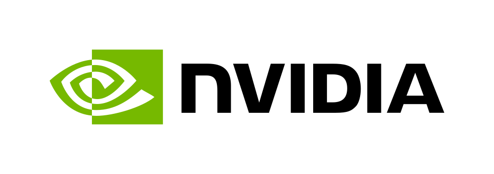
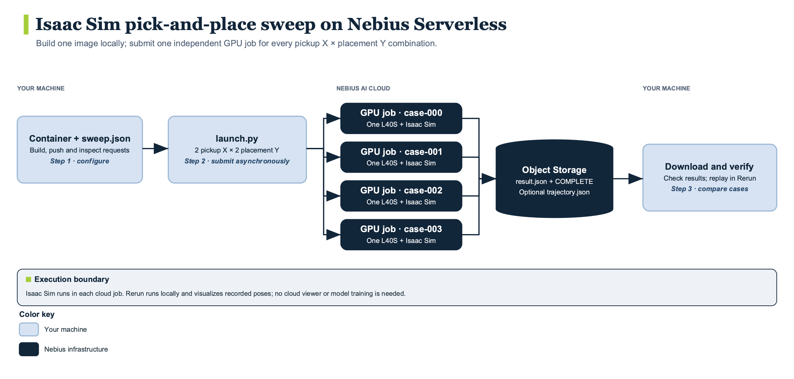
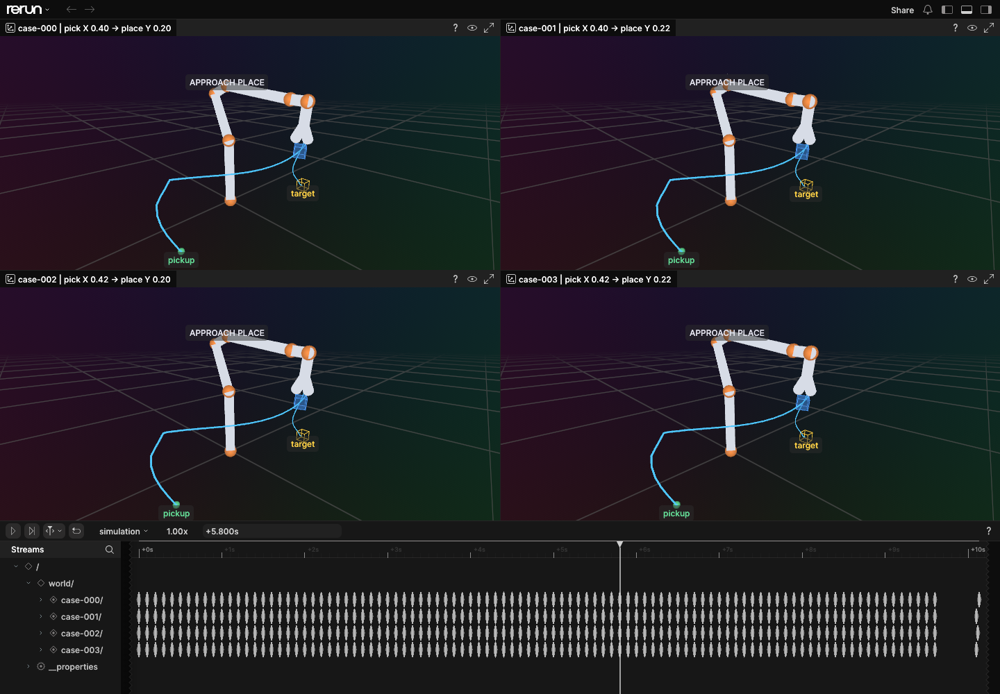

<p align="center">
  <a href="https://nebius.com"><picture>
    <source media="(prefers-color-scheme: dark)" srcset="assets/nebius-white.svg">
    
  </picture></a>
  &nbsp;&nbsp;&nbsp;&nbsp;
  <a href="https://developer.nvidia.com/isaac/sim"></a>
</p>

# Isaac Sim Franka pick-and-place sweep on Nebius Serverless

Run a Franka Panda pick-and-place task in NVIDIA Isaac Sim. Start with one Nebius Serverless GPU job, then submit one independent job for each pickup X × placement Y combination in `sweep.json`. Each job publishes measured results and an optional motion recording to Object Storage. No model training is required.

Build and submit from your machine. Isaac Sim and its built-in task/controller run inside each cloud job; Rerun runs locally to replay recorded poses. A completed cloud job can still report a failed robot task: inspect both the job state and measured placement result.

## Reference run

| Measured on 2026-10-16 | Result |
| --- | --- |
| Compute | One NVIDIA L40S per job; `gpu-l40s-a`, `1gpu-8vcpu-32gb` |
| Single case | Completed; `success: true`; 1.17 cm XY placement error |
| Recorded sweep | Four independent jobs; all completed with `success: true` |
| Sweep XY placement error | 1.17–1.27 cm |
| Motion recording | 98 measured frames per case; about 10.1 seconds of simulated time |
| Verification | 14 S3 objects across the single case and sweep; final recorded poses matched results; replayed in Rerun 0.38.1 |
| Job elapsed time | About 13 minutes each, including provisioning and image pulling |

These are historical observations from one scene, not a robot benchmark or a prediction of queue time. The four jobs were submitted in about 20 seconds. Cost and peak memory/scratch usage were not measured. [Validation history and exact image digest](docs/advanced.md#verified-run).

## Workflow

[](assets/workflow.png)



The four cases at 5.8 seconds of simulated time. The simplified arm connects recorded Franka link origins; the blue cube and cyan path show measured motion, with a green pickup marker and yellow target. This is a pose visualization. The screenshots are from the earlier October 6 runs.

## Requirements and compute

- Authenticated Nebius CLI, Docker with Linux AMD64 support, AWS CLI, and Python 3.10+ for local checks and launch commands.
- A project, subnet, Container Registry, Object Storage bucket, and L40S quota in one region. Each concurrent case needs its own GPU allocation; the default sweep submits four jobs.
- A SecretStash secret with payload keys `AWS_ACCESS_KEY_ID` and `AWS_SECRET_ACCESS_KEY`, granting bucket write access. Local AWS CLI credentials need read access; deletion is optional.
- An RTX-capable platform and outbound access to NVIDIA's hosted assets. H100 and A100 lack the RT cores Isaac Sim requires. Review the [Isaac Sim 6.1 requirements](https://docs.isaacsim.omniverse.nvidia.com/6.1.0/installation/requirements.html).

| Stage | Resources | Work |
| --- | --- | --- |
| Local build and launch | Docker and Python; no local RTX GPU required | Build one image, inspect requests, and submit cases. |
| Serverless case | One L40S, 8 vCPUs, 32 GiB RAM; 2-hour timeout | Headless Isaac Sim 6.1.0; this example configures CPU physics. |
| Local replay | Optional `rerun-sdk==0.38.1` | Display recorded poses after download. |

The timeout is a ceiling. The tested worker reported driver **580.173.02**, below NVIDIA's listed Linux version **595.58.03**. The headless task passed on that worker; check driver compatibility for your allocation before running. [Recorded hardware details](docs/advanced.md#verified-run).

## Files

| Path | Purpose |
| --- | --- |
| `Dockerfile` | Pin Isaac Sim 6.1.0 and package the runner. |
| `run.py` | Run one task, measure placement, and publish artifacts. |
| `launch.py`, `sweep.json` | Expand the grid and submit one asynchronous job per point. |
| `visualize.py` | Replay measured trajectories locally in Rerun. |
| `test_recipe.py` | Lightweight launcher, task-result and publication regressions. |
| `images/`, `assets/` | Recorded screenshots, workflow diagram and brand sources. |
| `docs/advanced.md` | Validation history, console views and optional local GPU run. |

## 1. Configure and build the image

```bash
git clone https://github.com/nebius/serverless-ai-cookbook.git
cd serverless-ai-cookbook
```

If you are reading an unmerged PR, check out that PR here. Then enter the example:

```bash
cd robotics/isaac-pick-place-sweep
```

Prepare these resources once, then replace the configuration placeholders:

| Requirement | Setup and value to copy |
| --- | --- |
| CLI profile and project | [Install](https://docs.nebius.com/cli/install) and [configure the CLI](https://docs.nebius.com/cli/configure). Select a profile whose default project is the intended job project. |
| Subnet | [Find the subnet ID](https://docs.nebius.com/vpc/networking/resources), `vpcsubnet-…`, in that project and region. |
| Container Registry | [Create a registry and configure Docker authentication](https://docs.nebius.com/container-registry/quickstart); copy its `registry-…` ID. |
| Object Storage | [Create a bucket](https://docs.nebius.com/object-storage/quickstart) and [configure an AWS CLI profile](https://docs.nebius.com/object-storage/interfaces/aws-cli); copy its S3 name. |
| SecretStash | [Create a secret](https://docs.nebius.com/mysterybox/secrets/create) with both S3 payload keys and grant the job identity access. Copy its selector; [job secret injection](https://docs.nebius.com/serverless/jobs/manage) matches each environment variable to the same-named payload key. |

```bash
export NEBIUS_PROFILE=YOUR_PROFILE
export NEBIUS_SUBNET_ID=YOUR_SUBNET_ID
export NEBIUS_REGISTRY_ID=YOUR_REGISTRY_ID
export REGION=YOUR_REGION
export S3_BUCKET=YOUR_BUCKET_S3_NAME
export S3_SECRET=YOUR_SECRET_SELECTOR
export S3_ENDPOINT_URL="https://storage.$REGION.nebius.cloud"
export AWS_PROFILE=YOUR_OBJECT_STORAGE_PROFILE
export IMAGE="cr.$REGION.nebius.cloud/${NEBIUS_REGISTRY_ID#registry-}/isaac:$(date -u +%m%d%H%M%S)"
aws s3 ls "s3://$S3_BUCKET/" --endpoint-url "$S3_ENDPOINT_URL"
nebius registry configure-helper --profile "$NEBIUS_PROFILE"
docker build --platform linux/amd64 -t "$IMAGE" .
docker push "$IMAGE"
```

The Dockerfile pins the NVIDIA base image by tag **and digest**; it already includes boto3. To change Isaac versions, update both and retest. Only `Dockerfile` and `run.py` enter the build context. Use a fresh image tag after changing the runner. Passing `ACCEPT_EULA=Y` and `PRIVACY_CONSENT=Y` below accepts NVIDIA's terms; review them before submission. Keep credential values in SecretStash and your local AWS profile.

## 2. Run one recorded case

This case uses the positions in [NVIDIA's manipulation example](https://docs.isaacsim.omniverse.nvidia.com/6.1.0/core_api_tutorials/tutorial_core_adding_manipulator.html). The image entrypoint already runs `run.py`:

```bash
export RUN_ID="single-$(date -u +%Y%m%dT%H%M%SZ)-$RANDOM"
export CASE_COUNT=1
nebius ai job create \
  --profile "$NEBIUS_PROFILE" --subnet-id "$NEBIUS_SUBNET_ID" \
  --name "isaac-pick-$RUN_ID" --image "$IMAGE" --async \
  --platform gpu-l40s-a --preset 1gpu-8vcpu-32gb --timeout 2h \
  --env ACCEPT_EULA=Y --env PRIVACY_CONSENT=Y \
  --env "S3_BUCKET=$S3_BUCKET" --env "S3_ENDPOINT_URL=$S3_ENDPOINT_URL" \
  --env "AWS_DEFAULT_REGION=$REGION" --env S3_PREFIX=isaac-pick-place \
  --env-secret "AWS_ACCESS_KEY_ID=$S3_SECRET" \
  --env-secret "AWS_SECRET_ACCESS_KEY=$S3_SECRET" \
  --args "--run-id $RUN_ID --case-id case-000 --pick-x 0.4 --place-y 0.2 --record-motion"
```

Copy the printed job ID, follow logs, then inspect the terminal state:

```bash
export JOB_ID=YOUR_PRINTED_JOB_ID
nebius ai job logs "$JOB_ID" --follow --profile "$NEBIUS_PROFILE"
nebius ai job get "$JOB_ID" --format json --profile "$NEBIUS_PROFILE"
```

Require terminal **COMPLETED**, then use step 4 to download and check this case before starting a sweep. In the console, open **Serverless AI → Jobs** and search for its ID. [Console screenshots](docs/advanced.md#console-views).

## 3. Submit the four-job sweep

`sweep.json` has two pickup X and two placement Y values, creating four independent jobs. Inspect the requests first; `--dry-run` submits nothing:

```bash
python3 launch.py --image "$IMAGE" --bucket "$S3_BUCKET" \
  --region "$REGION" --s3-secret "$S3_SECRET" \
  --profile "$NEBIUS_PROFILE" --subnet-id "$NEBIUS_SUBNET_ID" \
  --record-motion --dry-run
python3 launch.py --image "$IMAGE" --bucket "$S3_BUCKET" \
  --region "$REGION" --s3-secret "$S3_SECRET" \
  --profile "$NEBIUS_PROFILE" --subnet-id "$NEBIUS_SUBNET_ID" --record-motion
```

The launcher returns after submission, prints each job ID and S3 URI, and writes `runs/<run-id>/jobs.jsonl`. It keeps earlier IDs if a later submission fails. Monitor those IDs individually with the commands in step 2; wait for every job to reach **COMPLETED** before downloading. Search the run ID in the console to see the whole sweep.

```bash
export RUN_ID=YOUR_RUN_ID_FROM_LAUNCH_OUTPUT
export CASE_COUNT=$(python3 -c 'import json; from launch import expand_sweep; print(len(expand_sweep(json.load(open("sweep.json")))))')
cat "runs/$RUN_ID/jobs.jsonl"
```

Use the configuration you submitted when calculating the case count. Increasing the grid submits more paid jobs; the launcher does not limit concurrency or wait for capacity.

## 4. Download, verify, and replay

Keep `RUN_ID` and `CASE_COUNT` from either the single case or sweep above. Run this from the cookbook directory after checking all job states. It stops on download/check failure and refuses an existing local directory:

```bash
(
set -euo pipefail
export RESULTS_DIR="results/${RUN_ID:?set RUN_ID}"
: "${CASE_COUNT:?set CASE_COUNT}"
mkdir -p results
mkdir "$RESULTS_DIR"
aws s3 sync "s3://$S3_BUCKET/isaac-pick-place/$RUN_ID/" "$RESULTS_DIR/" \
  --endpoint-url "$S3_ENDPOINT_URL"
python3 - "$RESULTS_DIR" "$RUN_ID" "$CASE_COUNT" <<'PY'
import json
import math
import sys
from pathlib import Path
from run import evaluate

root, run_id, count = Path(sys.argv[1]), sys.argv[2], int(sys.argv[3])
assert count > 0
for index in range(count):
    case_id = f"case-{index:03d}"
    folder = root / case_id
    assert (folder / "COMPLETE").read_bytes() == b"", f"{case_id}: missing/invalid marker"
    result = json.loads((folder / "result.json").read_text())
    assert result["run_id"] == run_id and result["case_id"] == case_id
    measured = evaluate(result["controller_done"], result["final_cube_position_m"], result["target_position_m"])
    assert result["success"] is True and measured["success"], f"{case_id}: task failed"
    for field in ("xy_error_m", "z_error_m"):
        assert math.isclose(result[field], measured[field], abs_tol=1e-6)
    recording = json.loads((folder / "trajectory.json").read_text())
    frames = recording["frames"]
    assert len(frames) > 1
    assert all(math.isfinite(f["time_s"]) for f in frames)
    assert all(a["time_s"] < b["time_s"] for a, b in zip(frames, frames[1:]))
    for frame in frames:
        assert all(math.isfinite(v) for v in frame["cube_position_m"])
        assert all(math.isfinite(v) for link in frame["link_positions_m"] for v in link)
        assert math.isclose(math.hypot(*frame["cube_orientation_wxyz"]), 1, abs_tol=1e-3)
    assert math.dist(frames[-1]["cube_position_m"], result["final_cube_position_m"]) < 1e-6
    print(f"{case_id}: passed; XY error {100 * measured['xy_error_m']:.2f} cm; {len(frames)} frames")
PY
)
```

Both commands above enable recording. Without `--record-motion`, only `result.json` and `COMPLETE` are published; omit trajectory checks for those runs. `COMPLETE` means upload finished, while `success` means the controller finished **and** measured XY and Z placement errors are each within **8 cm**. The checker above requires task success as well as complete artifacts.

```text
isaac-pick-place/$RUN_ID/
├── case-000/
│   ├── result.json
│   ├── trajectory.json    # only with --record-motion
│   └── COMPLETE           # published last
└── case-001/ …            # one folder per sweep point
```

For optional local replay, install the pinned viewer and open the downloaded case folders:

```bash
python3 -m venv .venv-rerun
source .venv-rerun/bin/activate
python -m pip install rerun-sdk==0.38.1
python visualize.py "results/$RUN_ID"/case-* --output "results/$RUN_ID/pick-place.rrd"
rerun "results/$RUN_ID/pick-place.rrd"
```

Press **Play** or scrub the **simulation** timeline to inspect pickup, lift, transfer, and release. Each panel is one job aligned by simulated time. [Rerun viewer controls](https://rerun.io/docs/getting-started/configure-the-viewer/navigating-the-viewer).


The same earlier recordings at 10.133 seconds. Use `result.json` for measured placement errors.

## Adapt and check locally

Edit `sweep.json` to change pickup X or placement Y values. Change `run.py` to edit the task, then build and push a new image. Arbitrary positions may be unreachable; keep failed task results when comparing cases. To change compute, pass `--platform` and `--preset` to `launch.py` and change the single-job command as well.

Run the lightweight regressions without contacting Nebius:

```bash
python3 -m unittest discover -p test_recipe.py -v
```

Fixtures cover grid expansion, command construction, task success and publication failures; they do not prove Isaac Sim or GPU execution. [Optional local RTX check](docs/advanced.md#optional-local-gpu-check).

## Storage, results, and interruption

Each job writes under `/tmp/isaac-results`, then uploads `trajectory.json` when enabled, `result.json`, and finally an empty `COMPLETE`. Upload errors fail the process. A task can produce complete artifacts with `success: false`; a provider failure or missing marker is incomplete evidence.

There is no checkpoint/resume path. After a failed or interrupted job, inspect its logs and partial prefix, then use a fresh run ID. The runner does not reject an existing cloud prefix: do not reuse run/case IDs. Submission failures can leave earlier jobs running; use the saved manifest before retrying. Local `runs/`, `results/` and `.venv-rerun/` are ignored by Git.

## Clean up

Cancel a specific unfinished job using its saved ID:

```bash
nebius ai job cancel "$JOB_ID" --profile "$NEBIUS_PROFILE"
```

For a sweep, use the IDs in `runs/$RUN_ID/jobs.jsonl`. Canceling stops the VM and deletes its scratch disk; uploaded objects and registry images remain. Save the results you need, then preview deletion of only this run:

```bash
aws s3 rm "s3://$S3_BUCKET/isaac-pick-place/${RUN_ID:?set RUN_ID}/" \
  --recursive --dryrun --endpoint-url "$S3_ENDPOINT_URL"
```

Inspect the list before removing `--dryrun`. Remove the local image with `docker image rm "$IMAGE"`; delete its remote tag separately when no longer needed. Preserve shared buckets, registries and credentials.

## Run with a coding agent

Paste this from the cookbook directory:

```text
Read README.md, Dockerfile, launch.py, run.py, sweep.json, and test_recipe.py.
Use existing Nebius profile, subnet, registry, S3 bucket and secret-selector
settings; ask for missing values. Never print credentials. Run local tests,
build and push one short-named Linux AMD64 image, and inspect a launcher dry-run.
Check RTX platform/driver requirements. Submit one recorded case first and save
its job/run IDs. Require terminal COMPLETED, download into a fresh directory,
and run the README artifact checks. Then submit the recorded four-job sweep,
retain the manifest, and monitor those jobs without duplicates. Verify every
case and replay the recordings in Rerun. Report image provenance, job states,
artifact locations and measured task outcomes. Keep historical results dated;
do not claim new GPU validation from local tests. Do not delete cloud resources.
```

## Troubleshooting

| Symptom | Diagnose and recover |
| --- | --- |
| Container fails before simulation | Check RTX GPU, NVIDIA driver, EULA/privacy settings, and access to hosted assets. |
| Pending job or capacity failure | Check L40S quota/capacity for each concurrent case; inspect existing jobs before retrying. |
| Image cannot be pulled | Confirm the tag exists in the profile's project registry and the selected region. |
| Simulation finishes but job fails | Check bucket write permissions, secret access and both payload key names; `COMPLETE` should be absent after failed publication. |
| Job completes with `success: false` | Inspect `controller_done`, final cube position and XY/Z errors; the task may be unreachable. |
| Download/check fails | Confirm every job is terminal, `RUN_ID` and case count match the manifest, and artifacts include `COMPLETE`. Keep partial files and use a fresh local directory to retry. |
| Rerun has no motion | Confirm `--record-motion` was used and `trajectory.json` exists. Rerun runs locally; inspect its simulation timeline. |

NVIDIA and Isaac Sim are trademarks of NVIDIA Corporation. [Brand asset sources](assets/branding-sources.json).
