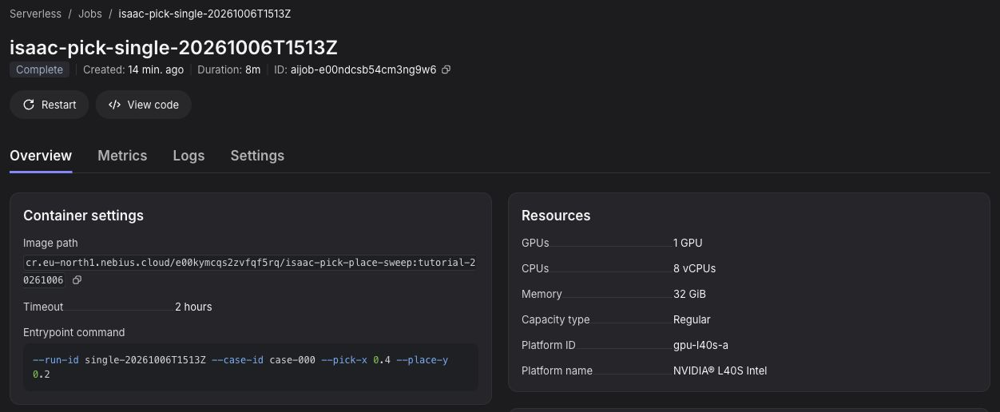
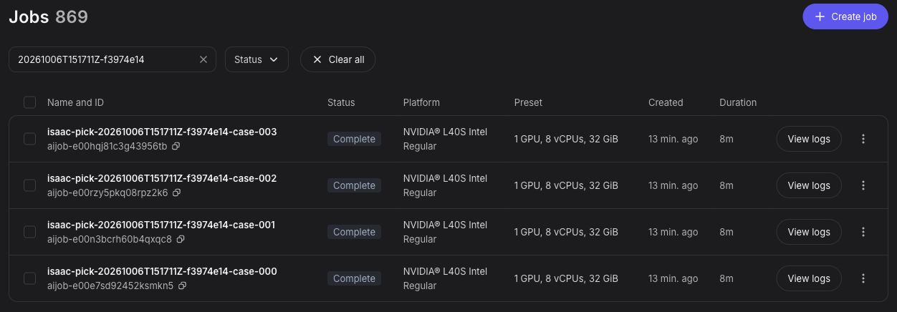
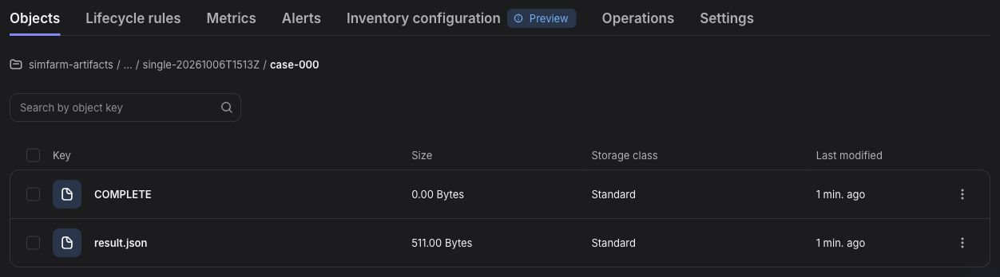

# Isaac Sim sweep details

[Back to the cookbook](../README.md)

## Verified run

On October 16, 2026, the digest-pinned Dockerfile was rebuilt and tested end to end: push the image, submit the single job and four-job recording sweep, download the results, and replay the recordings in Rerun 0.38.1. The tested image digest was `sha256:7efbc82dd4ba25f4bfdee85a4bdfe774afca271b01e3e1b56faece914de27568`.

On `gpu-l40s-a`, the single job completed with `success: true`, 1.17 cm XY error, and both S3 objects. The recording sweep submitted four independent jobs in about 20 seconds; all four completed with `success: true` and 1.17–1.27 cm XY error. Each case had all three S3 objects and 98 measured frames covering about 10.1 seconds. Every final recorded cube pose matched `result.json`.

Jobs took about 13 minutes each, including provisioning and image pulling. The cookbook console and Rerun screenshots were captured during the earlier October 6 validation runs.

The worker reported an NVIDIA L40S with 46,068 MB VRAM and driver 580.173.02. NVIDIA lists Linux driver 595.58.03 in its [6.1 requirements](https://docs.isaacsim.omniverse.nvidia.com/6.1.0/installation/requirements.html). This headless task passed on the tested worker, but its driver is below NVIDIA's listed version.

## Optional local GPU check

On a Linux host with a compatible RTX GPU, run one case without S3:

```bash
docker run --name isaac-pick-local --gpus all --shm-size 16g \
  -e ACCEPT_EULA=Y -e PRIVACY_CONSENT=Y \
  "$IMAGE" --run-id local --case-id case-000 \
  --pick-x 0.4 --place-y 0.2 --local
docker cp isaac-pick-local:/tmp/isaac-results/result.json ./result.json
docker rm isaac-pick-local
```

## Console views

In **Serverless AI → Jobs**, search for a job ID or the sweep run ID. The single
job and four-job sweep screenshots are from the October 6 runs; account and run
identifiers are redacted.





In **Object Storage → your bucket → isaac-pick-place → your run ID → case-000**,
inspect the published artifacts. This earlier unrecorded case has two objects;
the README commands enable recording and produce a third, `trajectory.json`.


