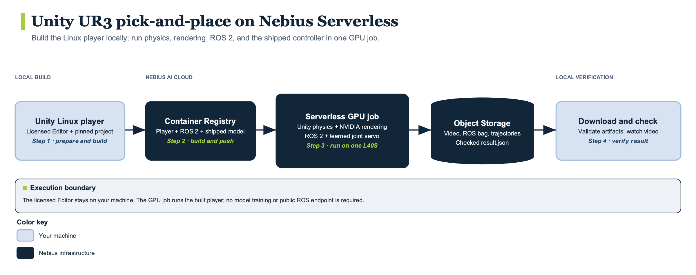
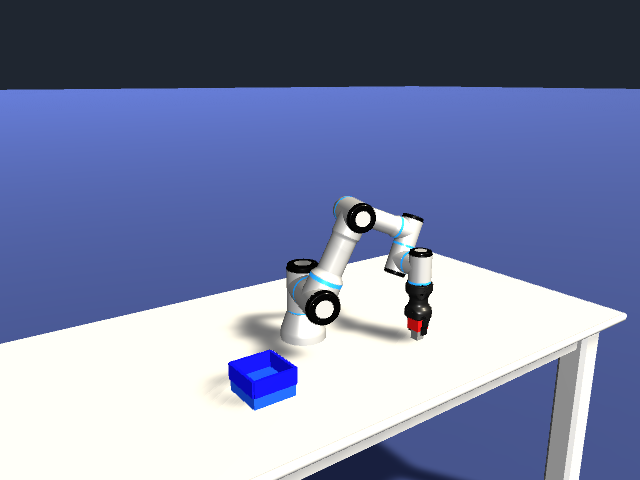
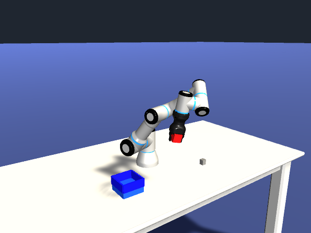

<p align="center">
  <a href="https://nebius.com"><picture>
    <source media="(prefers-color-scheme: dark)" srcset="assets/nebius-white.svg">
    
  </picture></a>
  &nbsp;&nbsp;&nbsp;&nbsp;
  <a href="https://unity.com"></a>
</p>

# Camera-guided Unity UR3 pick-and-place on Nebius Serverless

Run one GPU job that makes a UR3 pick up a red cube and place it in a blue tray. Unity simulates the robot and renders cameras on NVIDIA hardware. ROS 2 carries observations and commands; a Python controller combines camera detection, inverse kinematics, a programmed gripper sequence, and a shipped learned joint servo. No model training is required.

Build the Linux player once with a licensed Unity Editor on your machine. The player, ROS endpoint, controller, recording, and result publication then run together inside the Serverless job. Editor credentials stay outside the image.

## Reference run

| Measured on 2026-10-26 | Result |
| --- | --- |
| Compute | One NVIDIA L40S; ONNX inference on CPU |
| Container runtime | 1m 57s |
| Cube displacement | 53.9 cm |
| Placement error | 23.0 mm |
| Video | 52.7 seconds, 640×480, 15 FPS |
| Verification | 817 downloaded artifacts checked; ROS messages deserialized and ONNX actions replayed |

These are observations from one calibrated scene, not a performance guarantee. Container runtime includes startup, simulation, encoding, and publication; it excludes local preparation/build, image push, scheduling, and image pull. Cost and peak memory/scratch usage were not measured. The run used a freshly prepared pinned Unity project and rebuilt Linux player, with cached Docker dependency layers; [validation history](docs/advanced.md#validation-history) records those limits.

## Workflow

[](assets/workflow.png)

[](assets/pick-place.mp4)

[Watch the bundled video](assets/pick-place.mp4). It shows an earlier verified run; its provenance is separate from the reference measurement above. This demo assumes one red cube, a calibrated pickup surface, and an empty tray.

## Requirements and compute

- Unity Editor **6000.6.5f1**, licensed and installed with **Linux Build Support (Mono)**. See [Unity setup](docs/build-unity.md). No local NVIDIA GPU is required to build; running the Linux player requires native Linux x86-64 with NVIDIA graphics or the cloud job below.
- Docker with Linux AMD64 build support, authenticated Nebius CLI, and AWS CLI configured for Object Storage.
- Python 3.11+ and FFmpeg (`ffmpeg` and `ffprobe`) for local artifact checks. Extra policy/ROS checks run inside the image.
- A project, subnet, bucket, registry, and L40S quota in the same region. The robot source and shipped model are public and ungated.

| Stage | Resources | Work |
| --- | --- | --- |
| Local build | Licensed Unity Editor and Linux Mono module | Build a graphics-enabled player once; no Editor credentials in the image. |
| Serverless run | `gpu-l40s-a`, `1gpu-8vcpu-32gb`, 50 GiB scratch | One pick-and-place task; default simulation limit 180 seconds, job timeout 15 minutes. |

The timeout is a ceiling, not an estimated duration. The reference run downloaded 78.1 MB of artifacts; peak scratch usage was not measured. Keep the complete Linux player, including its libraries and `build.json`.

## Files

| Path | Purpose |
| --- | --- |
| `prepare.py`, `unity/` | Fetch pinned sources; prepare the scene and Linux build. |
| `Dockerfile` | Package the player, ROS 2 endpoint, controller, and checker. |
| `scripts/job.sh` | Dry-run or submit one Serverless job and print monitoring commands. |
| `check.py` | Independently validate downloaded video, images, trajectories, task evidence, and ROS counts. |
| `runtime/` | Runner, camera detection, kinematics, shipped model, and ROS controller. |
| `tests/`, `tools/` | Developer regressions and optional servo retraining. |
| `docs/` | Unity build details, control contract, adaptation, and validation history. |
| `assets/`, `validation.json` | Workflow, official branding sources, demo media, and recorded cloud evidence. |

## 1. Configure and build the Unity player

```bash
git clone https://github.com/nebius/serverless-ai-cookbook.git
cd serverless-ai-cookbook
```

If you are reading an unmerged PR, check out that PR here. Then enter the example:

```bash
cd robotics/unity-pick-and-place-demo
```

Prepare these resources once, then replace the placeholders in the configuration below:

| Requirement | Setup and value to copy |
| --- | --- |
| CLI profile and project | [Install](https://docs.nebius.com/cli/install) and [authenticate the CLI](https://docs.nebius.com/cli/configure); copy the profile name and `project-…` ID. |
| Subnet | [Find the subnet ID](https://docs.nebius.com/vpc/networking/resources), `vpcsubnet-…`, in the selected project/region. |
| Object Storage | [Create a bucket](https://docs.nebius.com/object-storage/quickstart) and [configure AWS CLI credentials](https://docs.nebius.com/object-storage/interfaces/aws-cli); copy its S3 name and `storagebucket-…` resource ID. |
| Container Registry | [Create a registry and configure Docker authentication](https://docs.nebius.com/container-registry/quickstart); copy its `registry-…` ID. |

```bash
export NEBIUS_PROFILE=YOUR_PROFILE
export NEBIUS_PROJECT_ID=YOUR_PROJECT_ID
export NEBIUS_SUBNET_ID=YOUR_SUBNET_ID
export NEBIUS_BUCKET=YOUR_BUCKET_S3_NAME
export NEBIUS_BUCKET_ID=YOUR_STORAGEBUCKET_ID
export NEBIUS_REGISTRY_ID=YOUR_REGISTRY_ID
export NEBIUS_REGION=YOUR_REGION
export NEBIUS_S3_ENDPOINT="https://storage.$NEBIUS_REGION.nebius.cloud"
export AWS_PROFILE=YOUR_OBJECT_STORAGE_PROFILE
export NEBIUS_IMAGE="cr.$NEBIUS_REGION.nebius.cloud/${NEBIUS_REGISTRY_ID#registry-}/ur3:$(date -u +%m%d%H%M%S)"
nebius iam project get "$NEBIUS_PROJECT_ID" --profile "$NEBIUS_PROFILE"
aws s3 ls "s3://$NEBIUS_BUCKET/" --endpoint-url "$NEBIUS_S3_ENDPOINT"
```

Use fresh `project/` and `build/` directories. Close this project in the Editor before a batch build:

```bash
python3 prepare.py
export UNITY_EDITOR='/path/to/Unity/Editor/Unity'
# macOS: /Applications/Unity/Hub/Editor/6000.6.5f1/Unity.app/Contents/MacOS/Unity
export UNITY_BUILD_DIR="$PWD/build"
"$UNITY_EDITOR" -batchmode -quit -projectPath "$PWD/project/ArmRobot" \
  -executeMethod DemoBuild.Linux -logFile "$PWD/build.log"
```

The build retains camera rendering. Do not add `-nographics` or strip player libraries. [Build details and pinned sources](docs/build-unity.md).

## 2. Build and push the container

```bash
docker build --platform linux/amd64 -t "$NEBIUS_IMAGE" .
docker push "$NEBIUS_IMAGE"
```

The Dockerfile pins the ROS base image and ROS TCP Endpoint commit. APT packages still come from live repositories. Keep the complete image reference at most 64 characters for the tested CLI/API path. Apple Silicon can build the image; local x86-64 emulation cannot run this graphics-enabled Mono player. [Optional native Linux GPU check](docs/advanced.md#optional-local-gpu-check).

## 3. Submit and monitor

```bash
export RUN_ID="pick-$(date -u +%Y%m%dT%H%M%SZ)"
bash scripts/job.sh dry-run
bash scripts/job.sh submit
```

The helper prints the run ID, artifact prefix, receipt location, and job lookup/monitoring commands. Save the returned job ID:

```bash
export JOB_ID=YOUR_JOB_ID
nebius ai job get "$JOB_ID" --profile "$NEBIUS_PROFILE"
nebius ai job logs "$JOB_ID" --profile "$NEBIUS_PROFILE" --tail 80
```

Require `COMPLETED` before downloading. A pending job only proves submission, not task execution. Use a fresh `RUN_ID` for each job. All ROS traffic stays inside the container; no public endpoint is required.

## 4. Download, verify, and watch

This block stops on errors and refuses existing local results. To repeat a download, move the previous local directory aside while keeping the cloud `RUN_ID` unchanged:

```bash
(
set -euo pipefail
nebius ai job get "$JOB_ID" --profile "$NEBIUS_PROFILE"
export RESULTS_DIR="results/$RUN_ID"
mkdir -p results
mkdir "$RESULTS_DIR"
aws s3 cp "s3://$NEBIUS_BUCKET/unity-articulations/$RUN_ID/" "$RESULTS_DIR/" \
  --recursive --endpoint-url "$NEBIUS_S3_ENDPOINT"
python3 check.py "$RESULTS_DIR"
)
```

The checker exits nonzero for missing images, invalid trajectories, incomplete recordings, CPU rendering, or missing physical grasp/carry/release/placement evidence. Successful output includes these `result.json` fields (other metadata omitted):

```json
{
  "success": true,
  "task": "pick_place",
  "renderer": {"vendor": "NVIDIA Corporation", "api": "OpenGLCore"},
  "cube_displacement_m": 0.5389,
  "placement_error_m": 0.0230
}
```

Expected outputs:

```text
unity-articulations/$RUN_ID/
├── result.json, simulation.json, renderer.json
├── preview.mp4, frames.csv, images/*.png
├── joints.csv, objects.csv, applied.csv, task.json
├── policy.jsonl, policy-metadata.json, perception.jsonl, camera.json
├── rosbag/metadata.yaml, rosbag/*.db3
└── *.log
```

Open `results/$RUN_ID/preview.mp4` in a video player as well. For full ROS message deserialization and recorded ONNX action replay, follow [the additional verification commands](docs/advanced.md#additional-artifact-checks).

| Grasp | Carry | Place |
| --- | --- | --- |
|  |  |  |

## Adapt and check locally

Change the scene/camera calibration in `unity/PickScene.cs`, detection in `runtime/perception.py`, and task poses/sequence in `runtime/policy_node.py`. Rebuild the player and image after scene changes. Different arms need matching kinematics and control conventions; the shipped servo and poses are specific to this UR3 scene. [Control contract and optional retraining](docs/advanced.md#control-contract-and-adaptation).

Run the lightweight checks without contacting Nebius:

```bash
python3 tests/test_task.py
python3 tests/test_demo.py
python3 -m unittest discover -s tests -p test_job.py -v
```

Local fixtures test validation and failure handling; they do not prove Unity or GPU execution. [Policy and ROS checks](docs/advanced.md#additional-artifact-checks) use the packaged dependencies.

## Storage, results, and interruption

The bucket is mounted at `/results`. Unity capture, ROS recording, and encoding use local scratch first; the runner copies file contents to Object Storage, checks the destination, and publishes `result.json` last. A failure retains available logs and partial artifacts and exits nonzero. A success receipt requires checked artifacts; a receipt alone does not replace terminal job status and independent download verification.

The job exits shortly after placement or fails at its simulation limit. Automatic restart is disabled. There is no resume path: inspect partial results and use a fresh run ID after an interruption. Existing cloud prefixes are rejected rather than overwritten. Generated `project/`, `build/`, and `results/` directories are excluded from Git; the Docker context includes only the player and required runtime files.

## Clean up

Cancel a specific unfinished job:

```bash
nebius ai job cancel "$JOB_ID" --profile "$NEBIUS_PROFILE"
```

Published artifacts and registry images remain and can incur storage charges. Keep the video and evidence until you have saved what you need. Preview deletion of only this run:

```bash
aws s3 rm "s3://$NEBIUS_BUCKET/unity-articulations/${RUN_ID:?set RUN_ID}/" \
  --recursive --dryrun --endpoint-url "$NEBIUS_S3_ENDPOINT"
```

Inspect the list before removing `--dryrun`. Remove the local image with `docker image rm "$NEBIUS_IMAGE"`; delete its remote image/tag separately when no longer needed. Preserve shared buckets, registries, and credentials.

## Run with a coding agent

Paste this from the cookbook directory:

```text
Read README.md, docs/build-unity.md, Dockerfile, scripts/job.sh, and check.py.
Use existing NEBIUS_* and AWS_PROFILE settings; ask for missing resource IDs.
Use the installed licensed Unity 6000.6.5f1 Editor with Linux Mono support.
Never print credentials or put Editor credentials in the image. Run local tests,
prepare fresh project/build directories, build the Linux player, build and push
one short-named Linux AMD64 image, and run bash scripts/job.sh dry-run.
Resolve validation errors before submitting one job. Record its ID and RUN_ID;
monitor that job without duplicates. Require terminal COMPLETED. Follow the
fail-fast Download, verify, and watch block; deserialize the ROS bag, replay
recorded ONNX actions inside the image, and inspect the video. Report image
provenance, runtime, artifact locations, and measured task results. Do not retrain
the model or delete cloud resources. Do not generalize one scene to other robots.
```

## Troubleshooting

| Symptom | Diagnose and recover |
| --- | --- |
| Unity build fails | Inspect `build.log`; confirm Editor 6000.6.5f1, Linux Mono support, active license, and fresh directories. [Unity setup](docs/build-unity.md). |
| Registry authentication or image-label error | Follow the registry setup link; keep the full image reference at most 64 characters. |
| Pending/capacity failure | Inspect `nebius ai job get "$JOB_ID" --profile "$NEBIUS_PROFILE"`; check L40S quota/capacity in the selected region before retrying. |
| Display startup fails or images are blank | Inspect `display.log`, `xorg.log`, `graphics.log`, and Unity logs. Retain NVIDIA graphics capabilities and player libraries; do not use `UseDisplayDevice=None` on the tested driver. |
| ROS startup or stale commands | Inspect `endpoint.log` and `policy.log`; confirm the pinned connector and `ROS2` scripting define. |
| Task stalls or placement check fails | Inspect phase, perception, and finger-contact records; verify scene geometry, mass, gripper force, camera calibration, and pickup-plane coordinates. |
| Output error, interruption, or missing receipt | Inspect job state and available logs. Check bucket write access, use a fresh run ID, and retain partial evidence. A failed job is not a successful task. |
| Existing local results | Move the old local directory aside before retrying the download. Do not change the cloud run ID to bypass the guard. |

More control and renderer details: [advanced guide](docs/advanced.md#troubleshooting). Exact current/historical measurements and image digests: [validation.json](validation.json).

These materials are not sponsored by or affiliated with Unity Technologies or its affiliates. Unity is a trademark or registered trademark of Unity Technologies or its affiliates in the U.S. and elsewhere. [Brand asset sources](assets/branding-sources.json).
